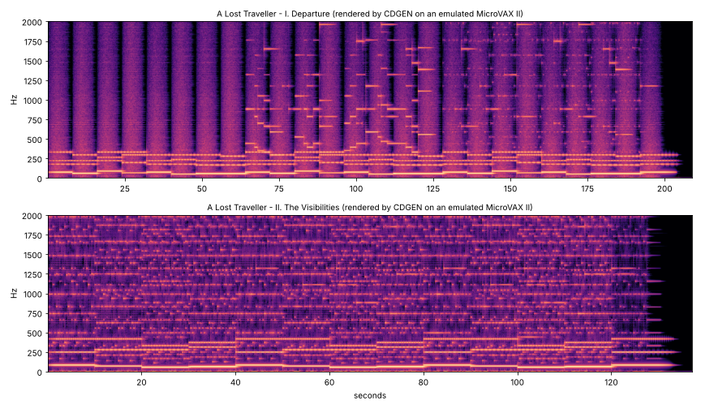

# A Lost Traveller — the VAX side

In the novel, Alan Fredericks buys a VAXstation in 1985 and writes a program in
VAX MACRO that turns a musical manuscript straight into the digital stream of a
Compact Disc. Nothing is ever played out loud and recorded. This directory
makes that real:

* **CDGEN** (`cdgen/CDGEN.MAR`) — Alan's program, about 1,900 lines of VAX
  MACRO-32 in the style of 1985. It reads a manuscript and computes every
  sample of the music: sine, chorused pad, FM, bell, plucked-string and noise
  voices, envelopes, panning and a hall reverberator. It writes Red Book CD
  audio, sector by sector.
* **MiniVMS** (`minivms/`) — a small VMS-like operating system, also in VAX
  MACRO. It runs CDGEN on a simulated MicroVAX II / VAXstation II: it has a
  login, DCL, `RUN`, an MSCP disk driver, a file system with version numbers,
  RMS (`$OPEN`, `$GET`, `$WRITE`, …), `$QIOW`, `$FAO`, `LIB$PUT_OUTPUT`,
  `CHMK` system services, user/kernel memory protection and VMS-style error
  messages.
* **macro32.py** (`tools/`) — a VAX MACRO-32 cross-assembler, so the MACRO
  source can be assembled without DEC's software, which can no longer be
  licensed.
* **The album** (`album/`) — manuscripts for two tracks of *A Lost Traveller*
  (1986), with MP3 previews of what CDGEN rendered on the emulated VAX.

None of it is DEC code. The CPU emulator is [open-simh](https://github.com/open-simh/simh),
which simulates the real KA630 processor board, the RQDX3 disk controller and
the console. Everything that runs on it was written for this project.



## Quick start

You need Linux or macOS with Python 3, a C compiler and git.

```sh
cd vax
make simh       # fetch and build the SIMH MicroVAX II simulator (once)
make            # assemble MiniVMS and CDGEN, build the system disk
make album      # boot the VAX, render both tracks, then make WAVs and a CD image
make run        # boot MiniVMS and use it yourself
```

`make album` leaves these files in `build/`:

| File | What it is |
|---|---|
| `DEPARTURE.CDDA`, `VISIBILITIES.CDDA` | exactly what CDGEN wrote on the VAX: raw CD audio |
| `DEPARTURE.wav`, `VISIBILITIES.wav` | the same bytes with a WAV header, to listen to |
| `A_LOST_TRAVELLER.bin` + `.cue` | a burnable audio-CD image, two tracks with 2-second gaps |

The `.bin`/`.cue` pair can be burned to a real CD-R and played in any CD
player. It takes about three minutes on a modern PC. `make run-1985` boots
the same system throttled to the speed of a real MicroVAX II.

## A session

```
  MiniVMS V1.0  on KA630 (MicroVAX II / VAXstation II)

%MOUNT-I-MOUNTED, TRAVELLER mounted on _DUA0: (311200 blocks)

Username: FREDERICKS
Password:

	Welcome to MiniVMS V1.0 on node TRAVELLER

$ DIR

Directory DUA0:[FREDERICKS]

CDGEN.EXE;1                  19  13-OCT-1986 00:15:51
CDGEN.MAR;1                  75  13-OCT-1986 00:15:52
DEPARTURE.MSS;1               6  13-OCT-1986 00:15:52
...
$ RUN CDGEN
CDGEN V2.3 - Compact Disc digital audio generator          A. Fredericks
Manuscript: DEPARTURE
CD audio file [DEPARTURE.CDDA]:
%CDGEN-I-SCORE, "Departure": 8 voices, 539 notes, tempo 60
%CDGEN-I-LENGTH, 3:29.00 to render, 15675 sectors, 36867600 bytes
    0:15:00     1125 sectors
    0:30:00     2250 sectors
    ...
%CDGEN-S-WRITTEN, 15675 sectors (3:29:00) written to DEPARTURE.CDDA
%CDGEN-I-PEAK, peak level 74% of full scale, 0 samples clipped
 ELAPSED:    0 00:01:59.59  CPU: 0:01:54.93  BUFIO: 19  DIRIO: 4504  FAULTS: 1374
$
```

Any user name and password are accepted. The DCL commands are DIRECTORY,
TYPE, RUN, DELETE, PURGE, SHOW (TIME, DEVICES, MEMORY, SYSTEM), HELP, LOGOUT
and SHUTDOWN. CTRL/Y interrupts a running program. After `SHUTDOWN`, type
`quit` at the `sim>` prompt.

## The manuscript language

A manuscript is a plain text file with type `.MSS`. `!` starts a comment.

```
TITLE   Departure
TEMPO   60              ! crotchets per minute
REVERB  35              ! reverberation send, percent
SPACE   85              ! size of the space, 0 (small room) .. 100 (cathedral)
MASTER  130             ! overall level, percent
TAIL    9               ! seconds of reverberation after the last note

VOICE 1 SINE   LEVEL 60 PAN 50 ATTACK 3000 DECAY 0 SUSTAIN 100 RELEASE 4000
VOICE 5 BELL   PAN 80 RATIO 3.5 INDEX 3

PART 1  MP |: D2/1~ D2/1  BB1/1~ BB1/1 :|3
PART 5  R/1 A5/2 E5/2 | R/2 D6/4 BB5/4 G5/1
END
```

**Voices** (up to 16; each plays one note at a time, so a chord needs several
voices):

| Type | Sound | Technique |
|---|---|---|
| `SINE` | pure tone | table look-up oscillator |
| `PAD` | soft, slowly beating chord tone | two oscillators detuned by `DETUNE` cents |
| `FM` | brass, reed, electric piano | Chowning two-operator FM (1973), as in the Yamaha DX7 |
| `BELL` | bells, gongs | FM with an inharmonic `RATIO` and a long decay |
| `PLUCK` | guitar, harp, koto | Karplus–Strong plucked string (1983), tuned with Jaffe–Smith all-pass filters |
| `NOISE` | wind, surf | white noise through a pitch-dependent two-pole filter |

**Voice parameters:** `LEVEL` and `PAN` (0–100), `ATTACK`, `DECAY` and
`RELEASE` (milliseconds), `SUSTAIN` (percent), `GATE` (percent of each note
the key is held), `RATIO` and `INDEX` (FM), `DETUNE` (cents, PAD), `DAMP`
(0–100, PLUCK sustain) and `TRANSPOSE` (semitones). Each type has sensible
defaults.

**Notes:** a letter, an optional `#` or `B` (flat), an octave (C4 is middle C,
A4 = 440 Hz), and an optional `/value`: `1 2 4 8 16 32 64`, followed by `.`
(dotted) or `T` (triplet). For example `C#4/8.` or `BB2/2`. A note with no
value keeps the previous value. `~` ties a note into the next one, with no new
attack. `R` is a rest. `PPP PP P MP MF F FF FFF` set the dynamic. `|: … :|n`
repeats a passage n times (twice if n is omitted), and repeats can nest. A
lone `|` is a bar line, for the reader only.

The timing is exact: note positions are kept in 1/1920ths of a whole note and
converted to samples per voice, so parts never drift apart.

## How it works

### The machine

SIMH's `microvax2` simulates the KA630 CPU board shared by the MicroVAX II and
the VAXstation II (1985). The VAXstation's QVSS graphics board needs SIMH's
SDL video support, so the scripts run the machine as a MicroVAX II with its
serial console. The CPU, memory and disk are the same. The machine has 5 MB of
memory and an RD54 159 MB Winchester on an RQDX3 controller.

### MiniVMS (`minivms/*.MAR`)

| File | Contents |
|---|---|
| `BOOT.MAR` | Start-up at physical address 0. Builds the system page table, maps the Q-bus I/O page and the TOY clock, sets up the Q22 bus map, turns on memory management, jumps into S0 space. Holds the system control block, the 100 Hz clock interrupt, and exception handling (`%SYSTEM-F-ACCVIO, access violation, reason mask=…`). |
| `CONSOLE.MAR` | Polled console terminal driver with type-ahead, line editing (DELETE, CTRL/U, CTRL/R, CTRL/Z) and CTRL/Y detection. |
| `DUDRIVER.MAR` | MSCP disk driver: the four-step UQSSP port initialisation, then SET CONTROLLER CHARACTERISTICS, ONLINE, READ and WRITE through command and response rings. |
| `FILES.MAR` | The MFS-1 file system (home block, one directory, contiguous files, `NAME.TYPE;version`) and RMS: `$OPEN $CREATE $CLOSE $ERASE $CONNECT $DISCONNECT $GET $PUT $READ $WRITE $REWIND` on VMS-style FABs and RABs. |
| `SYSSERV.MAR` | The system-service vector page (`SYS$EXIT`, `SYS$QIOW`, `SYS$FAO`, `SYS$GETTIM`, `SYS$EXPREG`, `LIB$PUT_OUTPUT`, `LIB$GET_INPUT`, `LIB$INIT_TIMER`, `LIB$SHOW_TIMER`, …), the `CHMK` dispatcher, and the image start-up and CTRL/Y stubs. |
| `SUPPORT.MAR` | `$FAO` formatted output (`!AS !UL !XL !8ZL !%D !%S …`) and timekeeping (VMS dates from day numbers, 64-bit VMS times). |
| `DCL.MAR` | Login, the command interpreter, the image activator (`RUN`) and the message table (`%RMS-E-FNF, file not found`). |
| `STARLET.MAR` | The user's macro library: `$FAB`, `$RAB`, `$OPEN`, `$QIOW_S`, `$FAO_S`, `$EXIT_S` …, plus the status codes and control-block offsets. |

Programs are linked at virtual address `^X200`, as on VMS, and run in user
mode. Page 0 is left inaccessible, so a null pointer gives an access
violation. P1 space holds a 64 KB stack. System services are reached by
`CALLS #n,G^SYS$xxx` into a user-readable vector page in system space. Each
vector executes `CHMK`, and the executive works on the caller's argument list
in kernel mode.

The time-of-year chip on a MicroVAX holds the month, day and time but not the
year. VMS kept the year on the system disk, and so does MiniVMS: the disk is
built with the year **1986**. `SHOW TIME` therefore gives today's date and
time in 1986.

What MiniVMS does not do: there is one user and no multiprocessing or paging.
DCL runs in kernel mode, not supervisor mode. The file system is a deliberately
simple relative of Files-11 with a single directory. Only terminal I/O goes
through `$QIO`. The status codes and control-block offsets follow VMS where
they were known; MiniVMS uses them only through its own definitions.

### The assembler (`tools/macro32.py`)

This is a MACRO-32 cross-assembler. Its opcode table is generated from SIMH's
decoder tables, and its output was checked against SIMH's disassembler. It
handles the whole instruction set and every addressing mode, including index
mode and the `B^ W^ L^ S^ I^ G^` operators. It also supports MACRO
expressions (left-to-right evaluation, `^X ^A ^M ^F`), local labels, psects
(including ABS), keyword macros with defaults, created labels (`?LBL`),
concatenation (`'`), `%LENGTH`, conditional assembly, `.REPT`/`.IRP`, VAX F, D
and G floating-point literals, and listings in DEC's format with code bytes
read right to left.

It differs from DEC's toolchain in one way: instead of `.OBJ` files and a
separate linker, all the sources are assembled together and laid out at a
fixed base address in one step. Symbols exported by the executive are
imported from `MINIVMS.STB`, the role `SYS.STB` plays on VMS:

```sh
python3 tools/macro32.py --stb build/MINIVMS.STB -o PROG.EXE -l PROG.LIS \
        minivms/STARLET.MAR PROG.MAR
python3 tools/vmsdisk.py put build/TRAVELLER.DSK PROG.EXE
```

### Host tools

* `tools/vmsdisk.py` — `init`, `put`, `get`, `dir` and `delete` files on an
  MFS-1 disk image.
* `tools/cdda.py` — `wav` (add a RIFF header), `cue` (assemble a multi-track
  BIN/CUE CD image), `info` (length, levels and pitch, for checking output).

## Notes for the novel

These facts came out of building and running the system. Some of them bear on
the plot.

**A CD could not be "written" in 1986.** Recordable CDs (CD-R) arrived around
1988–1990. In 1985–86 every Compact Disc was pressed from a master cut at the
pressing plant, from a digital tape: a Sony PCM-1610 or PCM-1630 processor
recording onto ¾-inch U-matic videotape. Alan's route from VAX to disc would
therefore be: CDGEN's sample stream, through a parallel interface (a DRV11-WA
on the Q-bus) into the PCM-1610's digital input, onto U-matic, and off to the
plant. The music is still never played out loud and recorded. Today, the
`.bin`/`.cue` that `make album` produces can be burned directly.

**The byte order is a happy accident.** CD audio samples are 16-bit two's
complement, least significant byte first. That is also the VAX's native byte
order, so CDGEN writes its words to the file with no conversion.

**Storage was tight.** CD audio is 10.1 MB a minute. "Departure" (3:29) is
36.9 MB and "The Visibilities" (2:17) is 24.2 MB. A VAXstation II typically
had an RD53 (71 MB), or later the RD54 (159 MB). A 45-minute album
(about 475 MB) could never be on disk at once, so it had to be rendered track
by track and dumped to tape. A TK50 cartridge, the MicroVAX II's tape drive,
holds about 95 MB: around nine minutes of music, so five or six cartridges for
the album.

**It was slow, and that is the texture of 1985–86.** Rendering "Departure"
with eight voices took about **3.2 billion VAX instructions**, roughly 15
million for each second of music. A MicroVAX II executes very roughly half a
million instructions a second. So that one track would have taken about
**1¾ hours**, around 30 times slower than real time. A full album would take
about a **day** of continuous computing, and every change to a manuscript
meant another render. (`make run-1985` lets you feel this.) The program prints
its progress in CD time (minutes:seconds:frames, 75 frames a second) and ends
with VMS's `LIB$SHOW_TIMER` statistics, much as Alan's would have.

**The techniques are all period-correct.** Chowning's FM was published in 1973
and licensed to Yamaha (DX7, 1983). The Karplus–Strong plucked string and
Jaffe and Smith's extensions were published in 1983. Schroeder's reverberator
dates from 1962. CDGEN computes its sine table with the VAX `POLYF`
(polynomial evaluation) instruction, and draws noise from the same
multiplier, 69069, as the VMS run-time library's random number generator.

## What is in this directory

```
Makefile               build, run and render
scripts/               SIMH command files; get-simh.sh
tools/macro32.py       MACRO-32 cross-assembler (+ vaxops.py opcode table)
tools/vmsdisk.py       MFS-1 disk image tool
tools/cdda.py          CD audio: WAV, BIN/CUE, analysis
minivms/               the MiniVMS executive and STARLET.MAR
cdgen/CDGEN.MAR        Alan's renderer
examples/HELLO.MAR     a first MiniVMS program
album/*.MSS            manuscripts for A Lost Traveller
album/preview/         MP3s and spectrograms of the rendered tracks
```

## Possible next steps

* **VAX FORTRAN** for the astrophysics: star-formation simulation and
  maximum-entropy reduction of the visibilities. The options are gfortran with
  `-fdec` on the host, a FORTRAN 77 compiler that emits MACRO-32 for this
  assembler, or running 4.3BSD's `f77` on the same simulator.
* **TK50 tape output** from CDGEN through the TQK50, which also uses MSCP, for
  the dump-to-tape step.
* **A real boot block**, so the system boots from the console ROM with
  `>>> B DUA0`.
* **The VAXstation's QVSS screen**, with SIMH built against SDL.
